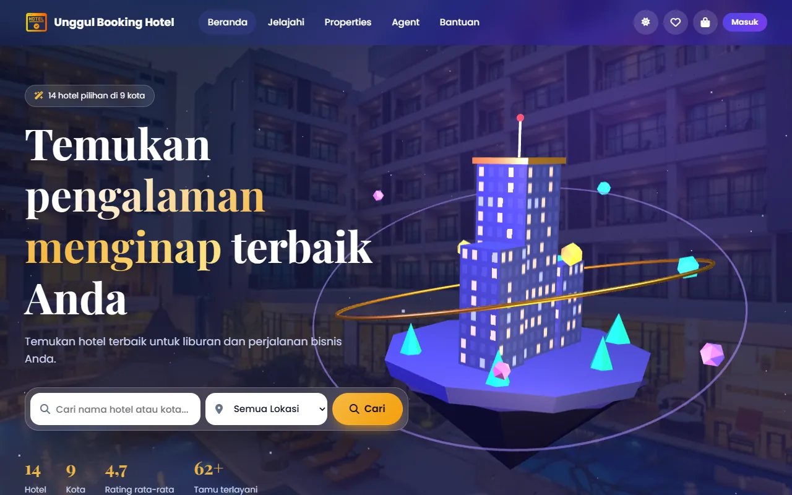
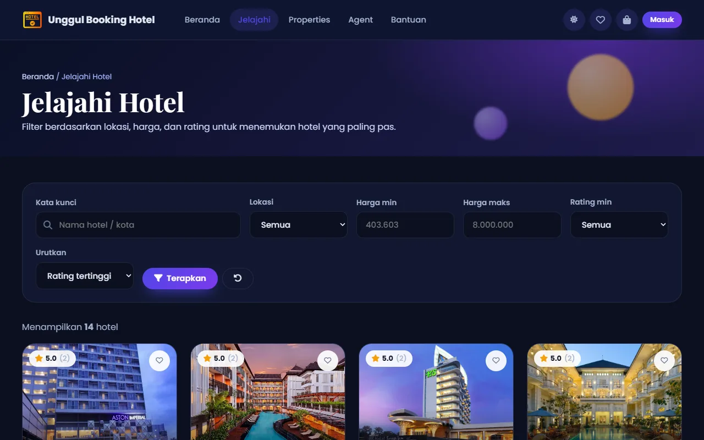
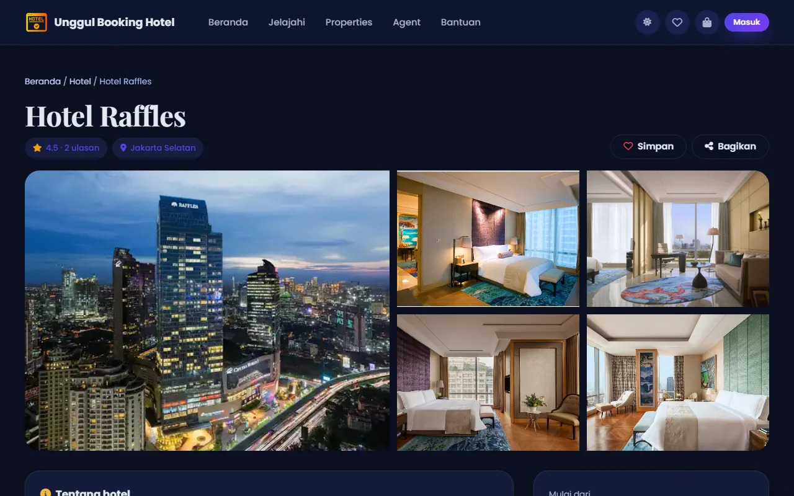
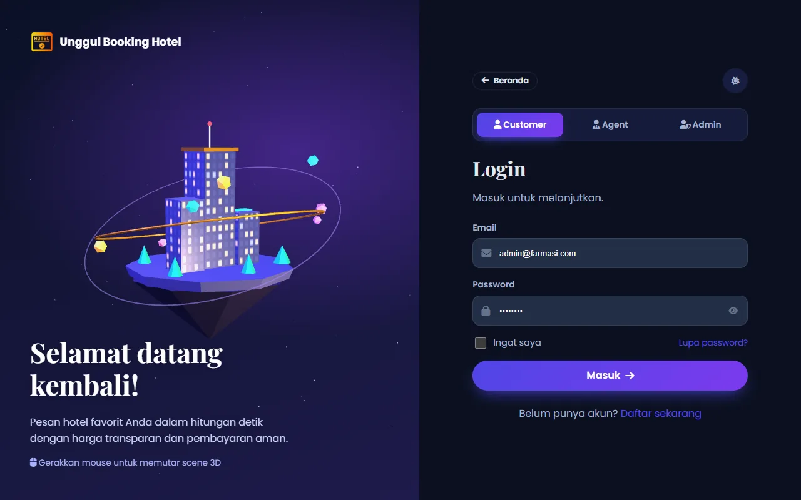
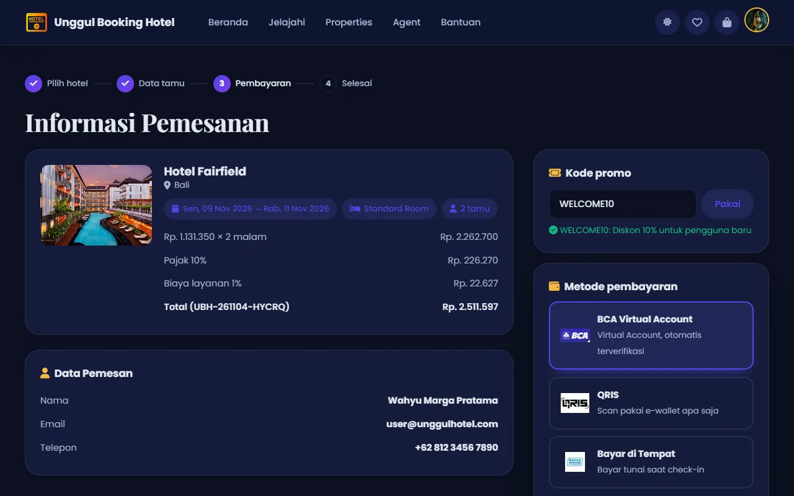
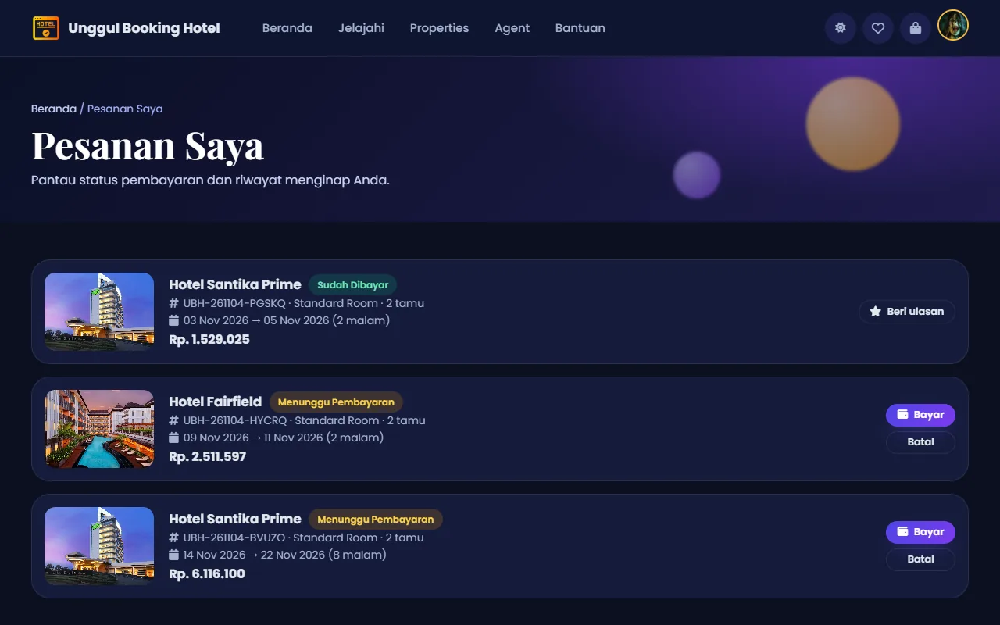
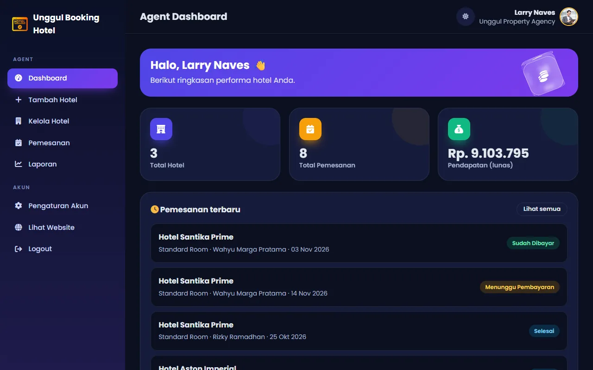
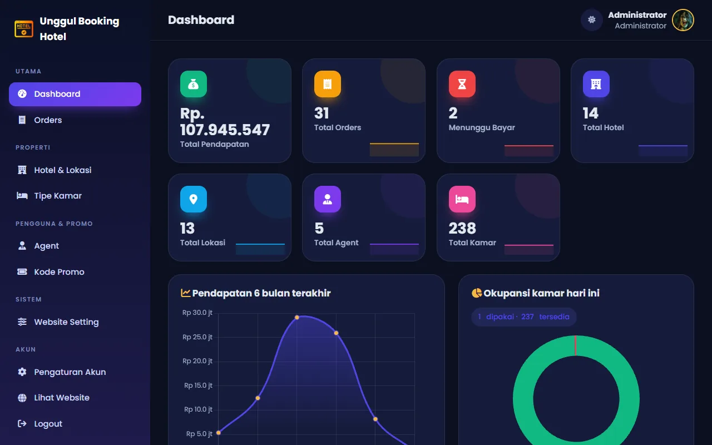
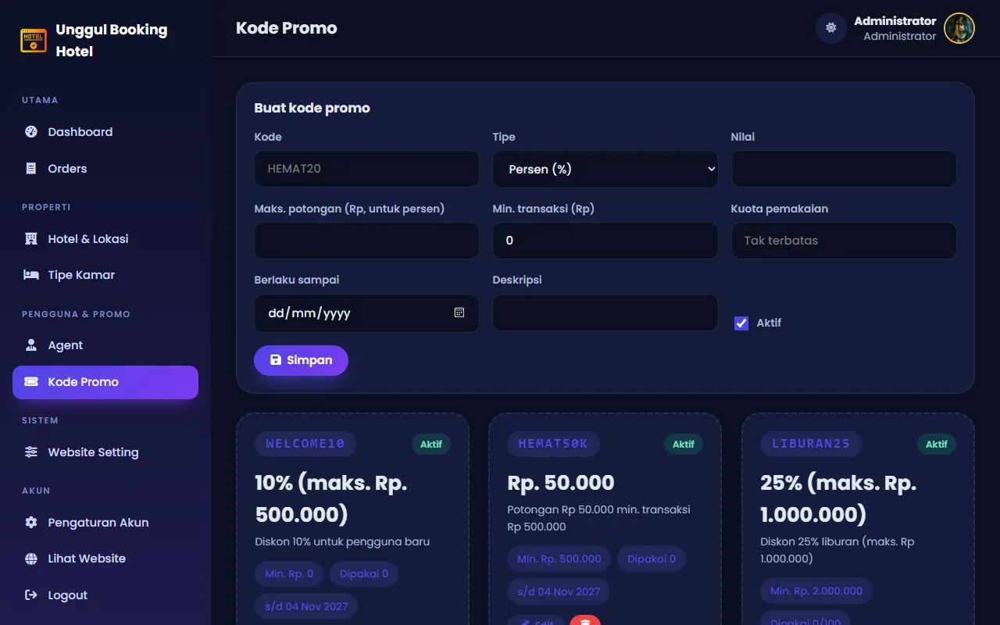

# 🌐 Unggul Booking Hotel

Aplikasi web pemesanan hotel dengan tiga peran (Customer, Agent, Admin), dibangun ulang menggunakan **Laravel 12**.



## 📸 Tampilan

| Jelajahi hotel (filter & urutan) | Detail hotel |
|---|---|
|  |  |
| **Login dengan scene 3D** | **Pembayaran + kode promo** |
|  |  |
| **Pesanan Saya** | **Dashboard Agent** |
|  |  |
| **Dashboard Admin** | **Kelola Kode Promo** |
|  |  |

## 🧩 Fitur

| Peran | Fitur |
|---|---|
| **Publik** | Beranda dengan scene 3D + pencarian live, Jelajahi (filter harga/rating/urutan), detail hotel (galeri, fasilitas, ulasan), Properties, daftar Agent, chatbot bantuan, mode gelap, pilihan bahasa (ID/EN/JA/ZH) |
| **Customer** | Registrasi/login, lupa password, wishlist, keranjang, booking (cek ketersediaan kamar), kode promo, pembayaran BCA VA / QRIS / COD, invoice cetak, ulasan & rating, Pesanan Saya, profil & ganti password |
| **Agent** | Dashboard statistik nyata, tambah/edit/hapus hotel (upload gambar), daftar pesanan, laporan bulanan & pendapatan per hotel |
| **Admin** | Dashboard realtime + grafik pendapatan, kelola kode promo, kelola hotel (Location), kelola tipe kamar (Property), kelola order, kelola agent, Website Setting (judul, warna, logo, footer, mode maintenance, bahasa, zona waktu), ganti foto profil |

Harga selalu dihitung di server: `harga kamar × malam + pajak 10% + biaya layanan 1%`.
Tipe kamar bawaan: Standard (×1), Deluxe (×1,5), Suite (×2).

## 🛠️ Teknologi

- PHP 8.2+, Laravel 12, Eloquent ORM
- Database: SQLite (default) atau MySQL/MariaDB
- Blade + design system sendiri (`public/css/modern.css`, mode terang/gelap)
- Three.js (scene 3D), Chart.js, Cropper.js, Font Awesome

## 🚀 Instalasi

```bash
git clone https://github.com/whympxx/UnggulBookingHotel.git
cd UnggulBookingHotel
composer install
cp .env.example .env
php artisan key:generate
php artisan migrate --seed
php artisan serve
```

Buka http://localhost:8000.

**Memakai MySQL (XAMPP)**: buat database `hotel_booking`, lalu ubah `.env`:

```env
DB_CONNECTION=mysql
DB_HOST=127.0.0.1
DB_PORT=3306
DB_DATABASE=hotel_booking
DB_USERNAME=root
DB_PASSWORD=
```

### Akun demo (password semua: `password`)

| Peran | Email | Login di |
|---|---|---|
| Admin | admin@unggulhotel.com | `/admin/login` |
| Agent | navesld@gmail.com (Larry Naves) | `/agent/login` |
| Customer | user@unggulhotel.com | `/login` |

Kode promo demo: `WELCOME10`, `HEMAT50K`, `LIBURAN25`.

### Pengaturan `.env` khusus

| Variabel | Fungsi |
|---|---|
| `ADMIN_REGISTRATION_CODE` | Kode undangan registrasi admin. Kosong = registrasi admin publik ditutup. |
| `FEATURE_PAYMENT_SANDBOX` | `true` = tampilkan tombol simulasi "Saya Sudah Bayar" (belum ada payment gateway). |
| `MAIL_MAILER` | Default `log`: email reset password ditulis ke `storage/logs/laravel.log`. |

## 🧪 Test

```bash
php artisan test
```

Test mencakup halaman publik, registrasi/login tiap peran, alur booking → pembayaran, keranjang, hak akses agent/admin, dashboard, dan website setting.

## 📂 Struktur

```
app/
├── Http/Controllers/
│   ├── HomeController.php          # beranda, layanan, properties, agent, pencarian
│   ├── CartController.php          # keranjang (session server)
│   ├── BookingController.php       # form booking, Pesanan Saya
│   ├── PaymentController.php       # pilih metode, kode VA/QRIS/COD, konfirmasi
│   ├── Auth/                       # login, registrasi, reset password
│   ├── Account/                    # profil, password, bahasa
│   ├── Agent/                      # dashboard & CRUD hotel agent
│   └── Admin/                      # dashboard, hotel, kamar, order, agent, setting
├── Http/Middleware/                # EnsureRole, SetLocale, CheckMaintenanceMode
├── Models/                         # User, Hotel, RoomType, Booking, Payment, Setting
└── Services/BookingService.php     # validasi, cek ketersediaan, buat booking
database/
├── data/hotels.json                # data 14 hotel bawaan
├── migrations/
└── seeders/DatabaseSeeder.php
resources/views/                    # Blade (layouts, pages, auth, account, cart, bookings, payment, agent, admin)
public/css, public/images, public/js
routes/web.php
tests/Feature/
```

Gambar yang di-upload disimpan di `public/uploads/` (tidak ikut git).

## 📄 Lisensi

MIT
